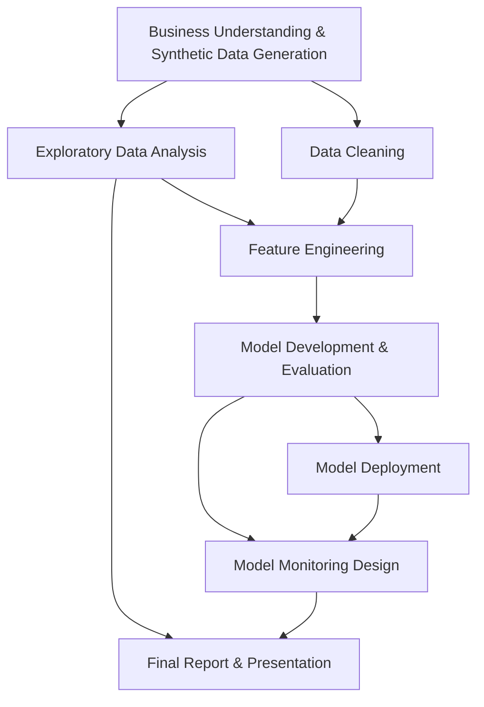

# House Price Prediction for a Real Estate Listing Platform

**Business Analytics | Group 22 | Group Project**

> **Project proposal and implementation roadmap.** This README defines the project scope, planned approach, and team workflow. It does not imply that any module, model, or deployment has already been completed.

## 1. Project Overview

Real estate listing platforms need a fast and defensible way to estimate property prices. Setting an asking price too high may discourage potential buyers, while setting it too low may reduce a seller's return.

This project addresses the business question:

> **Given a property's characteristics and location, what is its estimated market price, and how confident is that estimate?**

Group 22 will develop an **end-to-end Business Analytics solution** that combines data exploration, data preparation, feature engineering, regression modeling, deployment, and post-deployment monitoring. The intended outcome is a property valuation tool that presents an estimated price alongside an uncertainty range.

### Project objectives

- Understand the factors associated with residential property prices.
- Combine a real housing dataset with documented synthetic contextual features.
- Build and compare regression models using a reproducible evaluation process.
- Translate analytical findings into business recommendations for property valuation.
- Deploy a usable valuation interface and establish a monitoring workflow.

### Intended users and business value

| Stakeholder | Potential value |
| --- | --- |
| Property buyers | Reference price when evaluating listings |
| Property sellers | Support for setting an initial asking price |
| Real estate agents | Consistent, data-informed valuation assistance |
| Listing platform | Scalable price estimation and quality monitoring |

The predicted price is intended as **decision support**, not a replacement for a professional appraisal.

## 2. Data Sources

The project requires two sources:

### 2.1 Kaggle housing data (required)

**[House Prices – Advanced Regression Techniques](https://www.kaggle.com/competitions/house-prices-advanced-regression-techniques)**

This dataset describes residential properties in **Ames, Iowa, USA**, including attributes such as living area, building condition, construction year, neighborhood, and historical sale price. The target variable is **`SalePrice`** (USD).

The Kaggle `train.csv` contains labeled sales observations; its `test.csv` does not include `SalePrice`. The team will reserve labeled data for model validation and final evaluation rather than treating Kaggle's unlabeled test set as a ground-truth evaluation set.

### 2.2 Synthetic contextual data (required)

The team will **generate additional features in Python** and document their assumptions. Potential extensions include:

| Feature group | Examples | Purpose |
| --- | --- | --- |
| Neighborhood accessibility | Simulated distances to schools, hospitals, and public transport | Explore local convenience |
| Property history | Renovation indicators and renovation age | Capture condition-related context |
| Listing activity | Simulated days on market | Explore market activity; use only when known at prediction time |
| Macroeconomic context | Simulated interest-rate and housing-price-index trends | Illustrate possible market conditions |

All synthetic fields will be described in a **Data Dictionary** containing their name, data type, unit, valid range, and generation logic or business assumption. Synthetic features are not real geocoded measurements or verified economic observations and must be labeled accordingly.

## 3. Business Analytics Workflow

The work is structured into **eight modules** following the end-to-end analytics lifecycle.



| Module | Focus | Planned activities | Expected deliverables |
| --- | --- | --- | --- |
| **M1** | Business Understanding & Data Generation | Define valuation problem, business KPIs, generate synthetic data, document assumptions | Business scope, supplementary dataset, Data Dictionary |
| **M2** | Exploratory Data Analysis | Study distributions, missingness, outliers, correlations, and price patterns | EDA notebook, visualizations, business insights |
| **M3** | Data Cleaning | Review missing values, duplicates, categorical inconsistencies, and outliers | Cleaning pipeline, before/after quality report |
| **M4** | Feature Engineering | Create derived attributes, encode categories, scale where needed, assess multicollinearity and target skew | Reusable preprocessing pipeline, feature documentation |
| **M5** | Model Development & Evaluation | Compare regression algorithms, cross-validate, tune models, analyze residuals and errors | Model comparison, evaluation report, selected model |
| **M6** | Model Deployment | Serve price estimates and prediction ranges through an API and demo UI | Deployed API and valuation application |
| **M7** | Model Monitoring | Track incoming-data drift and prediction error when actual sale prices become available | Monitoring report/dashboard, retraining triggers |
| **M8** | Final Report & Presentation | Summarize analysis, business implications, limitations, and demonstrate the system | Final PDF report, PPTX slides, live/recorded demo |

### Planned handoff flow

1. **Data Engineering → Data Analysis / ML:** share datasets, schema, Data Dictionary, and cleaning decisions.
2. **Data Analysis → Team:** share explanatory charts and documented business insights.
3. **Feature Engineering / Modeling → Evaluation:** share preprocessing pipeline, model candidates, and training configuration.
4. **Modeling / Evaluation → Deployment:** share the selected model, input schema, error metrics, and method for producing a prediction range.
5. **Deployment / Evaluation → Monitoring:** share inference logs, reference feature distributions, and monitoring rules.
6. **All roles → Reporting:** contribute their own methodology, results, limitations, and recommendations.

Some activities can proceed in parallel; notably, EDA and deterministic cleaning, and early UI/API preparation while modeling is in progress.

## 4. Planned Analytical Techniques

### Data understanding and preparation

- **Data profiling:** missing-value counts, data types, ranges, and uniqueness checks.
- **EDA and visualization:** histograms, boxplots, scatterplots, grouped price comparisons, and correlation heatmaps.
- **Outlier detection:** IQR-based flags and contextual review rather than automatic deletion.
- **Cleaning and validation:** documented missing-value policies, categorical normalization, schema checks, and duplicate detection.
- **Synthetic generation:** Python-based sampling with reproducible seeds and stated business assumptions.

### Feature engineering and modeling

- Derived features such as house age, total area, renovation indicators, and amenity accessibility scores.
- Categorical encoding, numerical scaling where appropriate, feature selection, and multicollinearity checks (e.g., VIF).
- Target transformation (e.g., log price) when justified by the training distribution.
- Candidate regressors: **Linear Regression, Ridge, Lasso, Random Forest, XGBoost and/or LightGBM**.
- **K-fold cross-validation**, train-only preprocessing, hyperparameter tuning, and residual analysis.

### Evaluation metrics

| Metric | Interpretation |
| --- | --- |
| **MAE** | Mean absolute price error in USD |
| **RMSE** | Square-root mean squared price error; penalizes large errors |
| **MAPE** | Percentage prediction error, with attention to its limitations |
| **R²** | Proportion of target variation explained on the evaluation sample |

Model choice will consider **accuracy, interpretability, robustness, and business impact**, not just a single metric. The project will also evaluate methods for reporting a suitable **prediction interval**, which is distinct from a confidence interval for an average estimate.

### Deployment and monitoring

- **API:** FastAPI or Flask (planned).
- **Demo UI:** Streamlit (planned).
- **Hosting:** free-tier cloud platform such as Render, Hugging Face Spaces, or Streamlit Community Cloud, subject to platform constraints.
- **Monitoring:** feature-distribution drift, rolling MAE/RMSE when actual sale prices are available, and documented retraining thresholds; Evidently is a possible tool.

**Prediction-time availability:** Features known only after a transaction, such as actual days on market or a future sale date, cannot be assumed available for an initial-listing valuation. Synthetic contextual features must either be reproducibly generated for new listings, replaced by actual observable data, or excluded from the deployed model.

## 5. Team Organization

The team consists of **five members**, with responsibility areas proposed as follows. Ownership can be adjusted based on practical skills and workload.

| Role | Primary scope | Key handoff |
| --- | --- | --- |
| **ML Engineer – Modeling** | M4–M5 | Preprocessing, model training, model artifacts |
| **ML Engineer – Evaluation** | M5 and monitoring design in M7 | Metrics, validation, residuals, uncertainty analysis |
| **Data Engineer (Lead)** | M1 and M3 | Supplementary data, cleaning rules, Data Dictionary |
| **MLOps Engineer** | M6 and implementation of M7 | API, UI, cloud deployment, dashboard |
| **Data Analyst / Business Analyst** | M1, M2 and M8 coordination | EDA insights, business interpretation, report coordination |

Each member owns and documents their technical contribution; the final report and presentation are a **shared team responsibility**.

## 6. Proposed Project Schedule

The assignment suggests an adjustable **eight-week** plan. Actual deadlines will follow instructor announcements.

| Period | Planned milestones |
| --- | --- |
| **Weeks 1–3** | Business scope, Kaggle and synthetic data, EDA, cleaning checkpoint |
| **Weeks 4–5** | Feature engineering, model comparison, cross-validation checkpoint |
| **Weeks 6–7** | API/UI deployment, monitoring dashboard and triggers checkpoint |
| **Week 8** | Integration testing, documentation, final report and presentation |

## 7. Repository Organization (Proposed)

The repository will be organized around the following structure as development progresses. Not all folders or files are expected to exist at project initiation.

```text
.
├── house-prices-advanced-regression-techniques/   # Kaggle source files
├── data/
│   ├── synthetic/                           # Generated contextual data
│   └── processed/                           # Integrated / prepared datasets
├── notebooks/                               # EDA and modeling experiments
├── src/
│   ├── data/                                # Data generation / validation
│   ├── features/                            # Feature processing
│   ├── models/                              # Model training and evaluation
│   └── monitoring/                          # Drift and performance checks
├── api/                                     # Prediction service
├── app/                                     # Streamlit UI
├── docs/                                    # Dictionary and technical decisions
├── reports/                                 # Charts, monitoring, final outputs
├── tests/                                   # Automated checks
├── requirements.txt                         # Python dependencies (when finalized)
└── README.md
```

## 8. Development Principles

- **Reproducibility:** fixed random seeds, explicit dependencies, and rerunnable scripts.
- **No leakage:** any learned imputation, scaling, or feature selection must be fitted within training folds only. Do not use `SalePrice`-derived inputs to predict `SalePrice`.
- **Honest data provenance:** distinguish Kaggle measurements, derived variables, and simulated variables.
- **Separation of concerns:** organize data, analysis, modeling, and deployment code independently.
- **Quality assurance:** validate joins, row counts, IDs, expected schema, and permissible values.
- **Collaborative development:** develop on feature branches, use pull requests, and document interfaces at each handoff.
- **Original implementation:** all source code is written by team members, consistent with the assignment's prohibition of no-code/AutoML platforms.

## 9. Expected Final Deliverables

As specified by the assignment:

1. **Source code:** GitHub repository with notebooks and scripts.
2. **Data Dictionary:** Excel or Markdown file.
3. **Deployed valuation tool and API:** accessible live link.
4. **Monitoring dashboard or report:** notebook or Evidently-based report.
5. **Final report and slides:** PDF and PPTX.

## 10. Scope and Limitations

- The base dataset covers **historical sales in Ames, Iowa**. Results are not directly generalizable to other cities or the current real-estate market without additional data and validation.
- Synthetic data is designed to demonstrate contextual feature engineering; it does not establish observed causal relationships or guarantee better predictions.
- An estimated sale price is **not a formal appraisal** and should be accompanied by an explanation of uncertainty and known limitations.
- Monitoring prediction error requires observed sale prices to arrive after prediction; until then, only input quality and drift can be assessed directly.

---

**Course:** Business Analytics  
**Team:** Group 22  
**Project:** House Price Prediction for a Real Estate Listing Platform  
**Primary assignment:** `RealEstate_House_Price_Prediction_Project_Announcement.pdf`
